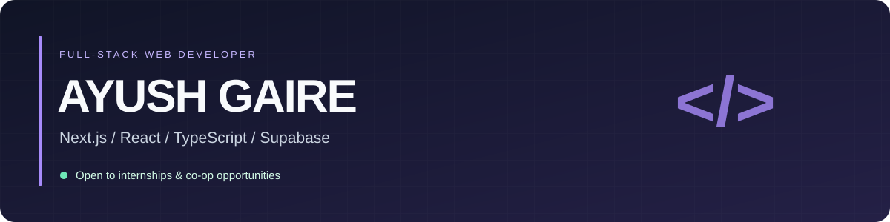

# Hi 👋, I'm Ayush Gaire

### Full-stack web developer building with Next.js + Supabase

I'm pursuing a **B.S. in Computer Science at Southwest Minnesota State University**. I build web applications with TypeScript, React, Next.js, and Supabase.

**Open to internships and co-op opportunities.**

[GitHub](https://github.com/ayushgaire) · [Email me](mailto:ayush.gaire@my.smsu.edu) · [Explore my repositories](https://github.com/ayushgaire?tab=repositories)

## Featured project

### 🌾 FarmFix

A modern farm maintenance management platform built with **Next.js and Supabase**.

[View source code](https://github.com/ayushgaire/-farmfix-memory) · [Live demo](https://farmfix-memory-zeta.vercel.app)

## Languages and tools

| Area | Technologies |
| --- | --- |
| Languages | TypeScript, JavaScript, HTML, CSS |
| Frontend | Next.js, React |
| Backend & data | Supabase, PostgreSQL |

## More of my work

- [Codyza Quest](https://github.com/ayushgaire/codyza-quest)
- [ResumeForge AI](https://github.com/ayushgaire/resumeforge-ai)
- [The Basic Game](https://github.com/ayushgaire/thebasicgame)

## Let's connect

Interested in my work or have an internship opportunity? Reach me at **[ayush.gaire@my.smsu.edu](mailto:ayush.gaire@my.smsu.edu)**.
